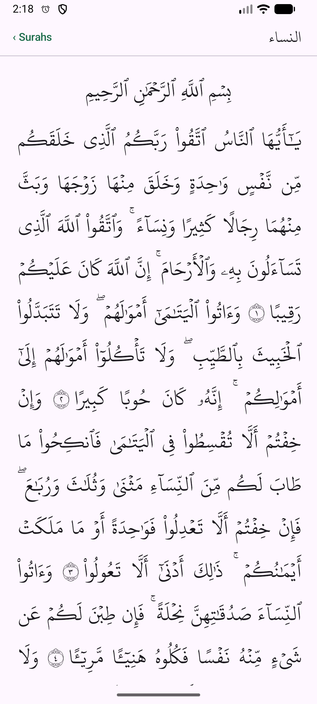
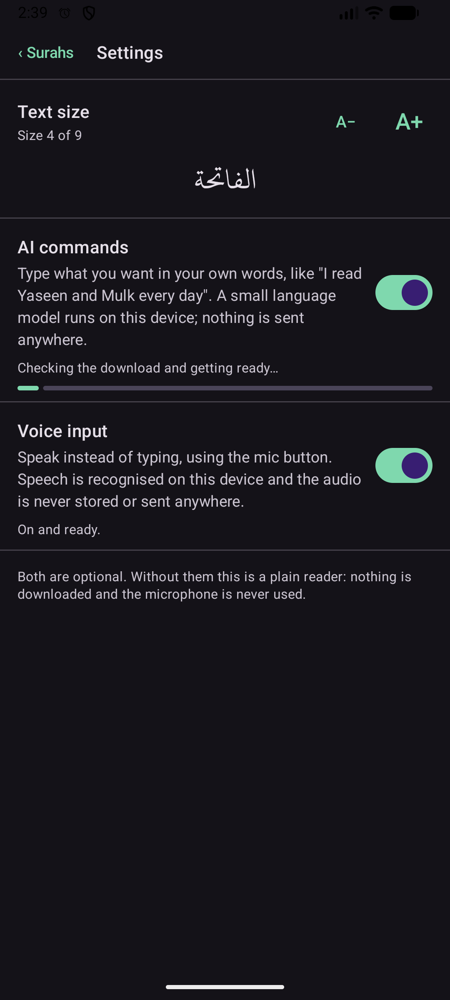

# Mazhar's Quran

A Quran reader with nothing but the Arabic text, whose layout you can change by typing or speaking. Say "I recite Yaseen and Mulk every day" and those surahs move to the top of the list. Everything runs on the device: the optional language model and speech recognition are downloaded once and work offline.

Built with Kotlin Multiplatform and Compose Multiplatform. Android is the working target; the shared code has an iOS entry point but no iOS app yet.

<p>
  
  
</p>

## What it does

- **Reader**: all 114 surahs in the KFGQPC Hafs Uthmanic font, with ayahs flowing continuously like a printed mushaf. No translation, no audio, no accounts.
- **Pinned surahs**: tap the star on a surah, or tell the app what you recite and when. "Every night I read Surah Mulk" creates a "Night" section; "on Fridays I read Al-Kahf" creates "Friday".
- **Go to an ayah**: "go to surah Fatiha ayat 3" opens the surah at that ayah and highlights it; inside a surah, "go to ayah 255" scrolls there; "go to the main screen" returns to the list. "2:255", "verse twenty one" and "the third verse" work too.
- **Text size and theme**: nine text sizes (A− / A+ buttons, or "make the font a bit bigger", "the biggest"), and light, dark and sepia themes ("dark mode", "it's too bright").
- **AI commands** (optional, 1.1 GB download): a small language model understands free phrasing such as "take Surah Mulk off my list".
- **Voice input** (optional, 57 MB download): tap the mic, speak, tap again.

Both optional features are off by default and are switched on in Settings. Without them the app is a plain reader: nothing is downloaded and the microphone is never used.

## How a command is understood

```
mic → speech-to-text → keyword rules → (language model) → action → layout state → UI
```

1. Keyword rules and a surah-name matcher run first. The matcher copes with spellings such as "yaseen", "ya sin", "wakia", Arabic script and "surah 36". If the rules are sure, their answer is used and the model is never woken.
2. Otherwise the model (Qwen2.5 1.5B Instruct, run by llama.cpp) classifies the intent. Its output is constrained by a grammar to a fixed set of actions, and any surah name it did not copy from what was said is discarded.
3. If the two disagree, or a name only matched approximately, the app asks "Did you mean …?" before changing anything. Every change can be undone.

The model can only ever emit one of a small set of typed actions (pin, unpin, open a surah or ayah, close, text size, theme, reset). It never generates UI and never touches the Quran text.

On the project's eval set of 100 transcripts, the rules alone get 94 right and rules plus model get 95. The set is small and was used while tuning, so treat those numbers as a regression check, not as real-world accuracy.

## Project layout

| Module | Contents |
|---|---|
| `shared` | Compose UI, the bundled Quran text and font, layout state and reducer, surah matcher, command interpreter, tests |
| `llm-android` | JNI wrapper around llama.cpp |
| `stt-android` | JNI wrapper around whisper.cpp, and microphone capture |
| `androidApp` | Android entry point, Settings downloads, launcher icon |

[docs/plan.md](docs/plan.md) records the design as built, including measurements.

## Building

You need:

- Android Studio, or a JDK 17+ and the Android SDK (platform 37)
- Android NDK `28.2.13676358` and CMake `3.22.1` (both installable from the SDK Manager)
- The llama.cpp and whisper.cpp sources, which are not vendored. Clone the pinned tags once, from the repository root:

```bash
git clone --depth 1 --branch b12360 https://github.com/ggml-org/llama.cpp.git .local/llama.cpp
```

```bash
git clone --depth 1 --branch v1.9.5 https://github.com/ggml-org/whisper.cpp.git .local/whisper.cpp
```

Then build and install the debug app:

```bash
./gradlew :androidApp:installDebug
```

The first build compiles both native libraries for `arm64-v8a` and `x86_64` and takes a few minutes.

The model files are not part of the build. The app downloads them when a feature is switched on in Settings, from fixed Hugging Face revisions, and checks each against a pinned SHA-256 before using it.

## Releases

The workflow in `.github/workflows/release.yml` runs the unit tests on every push and pull request, builds the APK on pushes to `main` (kept as a workflow artifact), and publishes a GitHub Release with the APK when a version tag is pushed:

```bash
git tag v1.0.0
```

```bash
git push origin v1.0.0
```

The tag sets the version shown in Settings. Between releases the version is the `app` entry in `gradle/libs.versions.toml`.

**Signing.** Android only installs an update over an existing app if both are signed with the same key. Until the repository has a release key, each CI build is signed with a throwaway debug key, so those APKs cannot update one another. To sign releases properly, create a keystore once, keep it safe, and add these repository secrets:

| Secret | Value |
|---|---|
| `RELEASE_KEYSTORE_BASE64` | the keystore file, base64-encoded |
| `RELEASE_KEYSTORE_PASSWORD` | the keystore password |
| `RELEASE_KEY_ALIAS` | the key's alias |
| `RELEASE_KEY_PASSWORD` | the key's password |

## Tests

```bash
./gradlew :shared:jvmTest
```

This runs on any machine without an emulator. It covers the layout reducer, persistence, the surah matcher and command rules, and the integrity of the bundled data:

- the Quran text file must match a pinned SHA-256, so any edit to it fails the build;
- every surah must have the right number of ayahs;
- the font must have a glyph for every character shown.

Scoring a model on the eval set needs a running `llama-server`; see the comment at the top of `LlmEvalTest.kt`.

## Status

- Developed and checked on an Android emulator only. Speed and battery use on a real phone are unmeasured, and voice input has been tested with synthetic speech, not real voices.
- The model needs a one-time warm-up after each app start before its first answer; until then commands use the keyword rules.
- iOS: the shared code has an iOS entry point that has never been compiled. There is no Xcode project and no iOS implementation of downloads, the model or speech.

## Text, font and third-party software

- **Quran text**: [Tanzil Project](https://tanzil.net) Uthmani text, version 1.1, bundled verbatim under Creative Commons Attribution 3.0. Tanzil's terms do not allow the text to be changed.
- **Font**: KFGQPC HAFS Uthmanic Script by the King Fahd Glorious Quran Printing Complex, bundled unmodified. Its licence allows free use and distribution and forbids selling or modifying the font; see [docs/licenses/KFGQPC-Hafs-LICENSE.txt](docs/licenses/KFGQPC-Hafs-LICENSE.txt).
- Everything else is listed in [THIRD_PARTY_NOTICES.md](THIRD_PARTY_NOTICES.md).

## Licence

No licence has been chosen for this project's own code yet. Until one is added, the code is published for reading only; the bundled text and font keep their own terms above.
